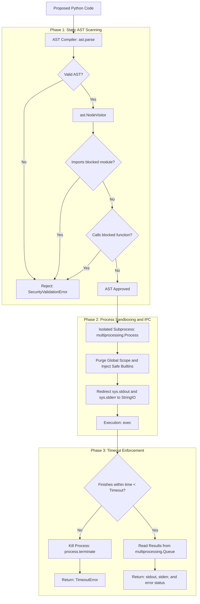

# Secure Tool Runtime

Secure execution environment (Sandbox) designed to compile and run interpreted Python code fragments in an isolated, controlled way. This component gives autonomous agents the ability to process dynamic scripts and evaluate complex mathematical formulas (Tool-calling) safely, neutralizing command injection, unauthorized access to the local filesystem, network leaks, and denial-of-service (DoS) attacks from infinite loops.

## Multi-Step Security Architecture

The execution engine's security is organized into three overlapping layers that protect the operating system's main supervisor thread.



### 1. Static Code Validation (AST Analysis)

Naive text-string filtering (e.g. searching for substrings like `"import os"` or `"open"`) is easily evaded via obfuscation techniques, hexadecimal encoding, or indirect calls such as:
```python
getattr(sys.modules["__builtins__"], "op" + "en")("/etc/passwd")
```

To prevent this, `SecureToolRuntime` parses the source code into an Abstract Syntax Tree (AST) before compiling it:
*   **Structural Analysis:** The `ASTSafetyValidator` module inherits from `ast.NodeVisitor` and inspects the script's grammar at compile time.
*   **Import Blocking:** Intercepts `ast.Import` and `ast.ImportFrom` nodes, immediately rejecting imports of system, network, or reflective execution modules:
    $$\text{Banned Modules} = \{\text{os, sys, subprocess, socket, builtins, shutil, ctypes, requests, urllib, pty, platform}\}$$
*   **Call Blocking:** Intercepts `ast.Call` nodes, detecting direct or attribute-based calls to banned scope- and file-manipulation functions:
    $$\text{Banned Calls} = \{\text{eval, exec, open, compile, getattr, setattr, globals, locals, \_\_import\_\_, input, exit, quit}\}$$

### 2. Execution Isolation (Process Sandboxing)

Once approved by the AST scanner, the code is executed in an independent operating system process via `multiprocessing.Process`. This isolates execution from the parent process's memory and protects the orchestrator against segmentation faults or interpreter overflows.

*   **Builtins Restriction:** The module's global builtin function dictionary (`__builtins__`) is redefined to a whitelist of safe math utilities and iterators (`abs`, `len`, `range`, `print`, `dict`, `list`, `sum`, etc.), suppressing any access to module loaders or sockets.
*   **Output Stream Redirection:** The `sys.stdout` and `sys.stderr` streams are captured in isolation, dumping output to local `io.StringIO` buffers for agent auditing.
*   **Inter-Process Communication (IPC):** A thread-safe `multiprocessing.Queue` is used to send a tuple with the execution results, the captured output, and the detailed error trace back to the supervisor process.

### 3. Resource Limits (Timeout Enforcement)

To prevent CPU attacks or unintended infinite loops in agent-generated scripts (e.g. `while True: pass`), the supervisor process blocks execution using a timer:

```python
process.join(timeout=timeout_seconds)
```

If the subprocess is still active once the allotted time (defaults to `2.0` seconds) has elapsed, it is forcibly terminated by sending a `SIGTERM` signal via `process.terminate()`. The state is then updated and a controlled timeout error is returned.

## Connection to the Ecosystem

This module provides operational security for the following calls:
1.  **orchestra-agents:** The ecosystem's autonomous agents register this secure environment's console as a basic tool (e.g. `execute_python`), enabling them to solve math problems, analyze text strings, and run logic simulations without compromising the host machine.
2.  **llm-guardrails-shield:** The firewall can redirect fragments of LLM output suspected of containing executable code to be parsed by this module's AST validator before granting serving authorization.

## Project Structure

*   `runtime.py`: Contains the static validator `ASTSafetyValidator`, the isolated execution worker function, and the main `SecureToolRuntime` class.
*   `test_runtime.py`: Integration tests that verify the interception of `open`, `eval`, and covert imports, control of the captured output, and interruption by timeout for infinite loops.
*   `example.py`: Interactive script that illustrates successful execution of safe scripts, static blocking of injections, and controlled termination of infinite loops.

## Using it as a package

Since `0.1.0` the code lives in the `secure_tool_runtime` package and the repository is
pip-installable, so other projects can depend on it instead of copying files
or editing `sys.path`:

```bash
pip install "secure-tool-runtime @ git+https://github.com/juanmmm21/secure-tool-runtime.git@v0.1.0"
```

```python
from secure_tool_runtime import SecureToolRuntime, SecurityValidationError
```

The old top-level modules are kept as thin re-exports, so scripts that add
this folder to `sys.path` keep working. This component imports no other
ai-core component: they are combined in the `aicore` SDK of
[ai-core-infra-hub](https://github.com/juanmmm21/ai-core-infra-hub), which
passes collaborators (vector stores, encoders, tokenizers) in by injection.

Development: `pip install -e ".[dev]"`, then `pytest` and `ruff check .`.

## Installation and Usage

### 1. Activate the Local Environment and Install Dependencies

Since the module leverages Python's native process-control core libraries, the requirements are minimal:

```bash
python3 -m venv .venv
source .venv/bin/activate
pip install -r requirements.txt
```

### 2. Run Automated Tests

```bash
.venv/bin/python -m unittest test_runtime.py
```

### 3. Run the Sandbox Demo

```bash
.venv/bin/python example.py
```

The script will graphically demonstrate in the console the three protection steps, printing the security alerts generated when attempting to invoke restricted commands and the runtime error capture.
